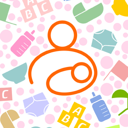

<p align="center">
  
</p>

# pybabytracker

Async Python client for the sync service of
[Baby Tracker](https://apps.apple.com/us/app/baby-tracker-newborn-log/id779656557), the app by
[Nighp](https://nighp.com), built for the
[Baby Tracker (Nighp) for Home Assistant](https://github.com/wtadler/ha-baby-tracker)
integration. It is unofficial and identifies itself as `pybabytracker/<version>`.

## Use

```python
import aiohttp
from pybabytracker import DIAPER_WET, BabyTrackerClient, SyncEngine

async with aiohttp.ClientSession() as session:
    client = BabyTrackerClient(
        "parent@example.com", "password", "STABLE-DEVICE-UUID", "Home Assistant", session=session
    )
    engine = SyncEngine(device_uuid="STABLE-DEVICE-UUID")  # or SyncEngine.from_dict(saved_state)
    result = await engine.sync(client)  # the first also reads the seed; then only what's new
    diaper = await engine.add_diaper(client, baby_id, DIAPER_WET)  # posts as this device
    await engine.delete_record(client, diaper.object_id)  # only records this device created
    saved_state = engine.to_dict()  # JSON-safe: save it after writes, and after a sync with
    # result.transactions_applied or result.seed_read
```

- Pass your own `aiohttp.ClientSession` (the client never closes it), and make it dedicated to
  this client: the service authenticates by cookie, so two accounts must not share a session (in
  Home Assistant, use `async_create_clientsession`). Without one, the client makes its own and
  closes it in `close()`.
- `AuthenticationError` means the credentials were rejected. `BabyTrackerConnectionError` means
  the service was unreachable or answered with a server error. A 401 mid-session triggers one
  sign-in and a retry before it becomes an `AuthenticationError`.
- `AccountChangedError` means a sign-in opened a different sync group (`AccountID`) from the one
  the engine's state came from: the group was reset in the app. The engine saves the first
  `AccountID` it sees and refuses to sync or write after it changes, as the app does; the client
  also refuses a sign-in to a different group from its own earlier one. Join the new group with a
  new `BabyTrackerClient` and a new engine (the aiohttp session can be reused). State saved before
  this version adopts the first `AccountID` it sees, so a reset that happened before upgrading
  isn't detected.
- `AccountResetError` (an `AccountChangedError`) means the service refused this device at sign-in
  because the account was reset: after a reset it refuses every device that joined before it,
  whatever the password, so it isn't an `AuthenticationError`. Join again as the app does, with a
  new device UUID, a new client and a new engine.
- Records are typed. Every type the apps sync is read: `Diaper`, `Formula`, `Pumped`,
  `Nursing`, `Sleep`, `Pump`, `OtherFeed` (solids), `Medication`, `Medicine`, `Temperature`,
  `Growth`, `Milestone`, `Vaccine`, `OtherActivity`, `Bath`, `Allergen`, `Sick`,
  `HealthQuestion`, `DoctorVisit`, `Joy`, `Journal`, and `Baby`, plus the pick lists
  `MedicationSelection`, `MilestoneSelection`, and `VaccineSelection`. The ones you can add are
  listed under [Record types you can add](#record-types-you-can-add). A record type the library
  doesn't know stays raw as an `UnknownRecord` (a debug line is logged once per type).
  `Medication` is a medicine dose with the medicine embedded, and `NursingSession`, the Android
  app's timed nursing, is a `Nursing`. The Android app sends codes such as a diaper's `status` as
  strings of digits and `englishMeasure` as a JSON boolean; `numeric_code()` reads either form,
  and volumes read both. Decoding then encoding any
  payload returns the same JSON, including keys the library doesn't model.
- Measurements read as `Measurement(value, unit)`: `Temperature.reading` (`"F"` or `"C"`), and
  `Growth.weight_reading` (`"lb"` or `"kg"`, decimal pounds), `length_reading`, and
  `head_reading` (`"in"` or `"cm"`). Each is `None` when the record has no such
  measurement.

## Writes

The engine posts as its own device (`device_uuid`, which must match the client's):

- A write needs a completed sync first (`NotSyncedError` otherwise), because the payload embeds
  the baby record as known from sync (`UnknownBabyError` for a baby it hasn't seen).
- Numbers are at-most-once. The next number is one more than the highest of this device's
  `LastSyncID` on the server, its own log already applied, and its last confirmed post. Before
  choosing, the engine applies any of its own log it hasn't seen (another process using the same
  device ID).
- When a post fails, the engine reads its own log at that number. If the same transaction is
  there, the write succeeded. Otherwise the error is raised and the post stays pending; the next
  write settles it first. After a definite HTTP error, a number nothing holds is reused. After
  no answer at all (`NoResponseError`: a timeout or dropped connection), the post may still
  land, so the number is reused only once `unknown_outcome_grace` seconds (default 90) have
  passed with nothing under it; until then a write raises `WriteOutcomeUnknownError` without
  posting. A 401 signs in again and resends the same number. Nothing is resent blindly.
- To retry an add safely, pass the same `object_id` again: if the earlier attempt landed after
  all, its record is returned instead of a second copy being posted.
- If this device's own log is shorter than its `LastSyncID`, a write is refused
  (`ProtocolError`) rather than skipping the missing entries.
- A confirmed write is applied locally at once, so the next sync doesn't fetch it back.
- Writes and syncs share a lock, so concurrent writes get consecutive numbers.
- `delete_record` only deletes records this device added (`NotOwnRecordError`), and raises
  `RecordNotFoundError` if one is already deleted. Like the app, the delete sends the record as
  last saved with only `newFlage` set to `"false"`; its timestamp is not bumped.
  With `any_device=True` it also deletes a record another device added, as the apps delete each
  other's records, with the same payload: a baby's records, pumps, pick-list entries, and
  babies. A pick-list entry another device added raises `EntryInUseError` while a record still
  names it (`entry_users(object_id)` counts them), and so does any baby that still has records
  (`baby_users(baby_id)`), since the apps refuse those deletes and post the entry or baby back.
- `entry_of(record)` is the pick-list entry a record names (a dose's medicine, a solid food's
  food, and so on), looked up by ID in the list's choices. Use it for the entry's current name:
  it follows a `rename_entry`, and it finds the entry for a seed row that carries only the ID
  because the seed doesn't hold the entry (such a record has no `food_name` of its own).
- `rename_entry(client, object_id, name)` renames a food, medicine, milestone, vaccine, or
  activity type that has a record of its own, with an update of that record (expected, not yet
  seen in synced data). A name another entry of the list has raises `SelectionExistsError`.
- `edit_record(client, object_id, time=, timezone_offset=, note=)` changes a saved record's
  time or note, whichever device made it, as the apps do when a record is edited: an update
  (opcode 1) carrying the record as last saved with only those keys, `newFlage` false, and
  `timestamp` changed. It edits a baby's record or a pump, and posts nothing when the record
  already has the values, so a retry is safe. A sleep's or nursing's length is kept when its
  start moves.
- `edit_diaper` (`status`, `amount`), `edit_bottle` (`volume`), `edit_nursing` (`left_minutes`,
  `right_minutes`, `finish_side`), `edit_sleep` (`start`, `end`), `edit_temperature`
  (`temperature`), `edit_growth` (`weight`, `length`, `head`), `edit_medication` (`amount`),
  `edit_other_feed` (`amount`, `unit`), `edit_activity` (`duration`), and `edit_pump` (`amount`
  or `left_volume`/`right_volume`, `left_minutes`, `right_minutes`, `finish_side`) change a
  record's own fields the same way, with the time, zone, and note in the same update, and with the checks of
  the matching `add_*`. A value not given is kept: a nursing's other side, and a sleep's end
  when its start moves (so it gets longer or shorter). When a nursing's minutes change, the keys
  an iPhone's timer left on it are dropped, as the iPhone app drops them; an Android timer's
  `NursingSession` keeps its minutes. The medicine, food, or activity type a record embeds
  can't be changed by an edit: delete the record and add another.
- `add_baby(client, name, birth=, boy=, due=None, photo=None)` adds a baby with a `Baby` record
  (expected, not yet seen in synced data: only a baby's updates have been). The returned baby's
  `object_id` is the `baby_id` for its records. A name another baby has raises
  `SelectionExistsError`, since the apps merge two babies of one name.
- `edit_baby(client, baby_id, name=, birth=, due=, boy=, photo=)` changes a baby with an update
  of its `Baby` record, as the iPhone app does. A `photo` (JPEG bytes) is uploaded first as a new
  uppercase UUID plus ".jpg" and again plus "_l.jpg" (the landscape copy, `landscape_photo` when
  given), and becomes the baby's `pictureName`. Records added afterwards embed the edited baby.
  A baby known only from the copies its records embed raises `RecordNotFoundError`: those can
  be partial, and after a seed read the baby's own record is there.
- Save `to_dict()` after every write, including one that raised: a pending post lives only in
  that state. Use one device ID per running process; two processes writing as one device can
  collide on a number while `LastSyncID` lags.

### Record types you can add

Every add shares the rules above (numbering, pending posts, `object_id` retries, local apply),
and bad input raises `ValueError` before any request. Payloads match the iPad capture key for
key.

| Method | Writes | Notes |
|---|---|---|
| `add_diaper(client, baby_id, status, amount=None, ...)` | `Diaper` | `DIAPER_WET`, `DIAPER_DIRTY`, `DIAPER_MIXED`, `DIAPER_DRY`; `amount` is one of `DIAPER_AMOUNTS` (none, light, normal, heavy, overflow, not set), by default normal, or none for a dry diaper |
| `add_formula(client, baby_id, volume=, ...)` | `Formula` | volume more than zero |
| `add_pumped(client, baby_id, volume=, ...)` | `Pumped` | a bottle of pumped milk |
| `add_nursing(client, baby_id, left_minutes=, right_minutes=, ...)` | `Nursing` | a finished session |
| `add_sleep(client, baby_id, start=, end=, ...)` | `Sleep` | a finished sleep |
| `add_pump(client, amount=, ...)` or `add_pump(client, left_volume=, right_volume=, ...)` | `Pump` | a pumping session; belongs to the account, so no `baby_id` |
| `add_milestone(client, baby_id, milestone, ...)` | `Milestone` | `milestone` is a name or ID from `milestone_choices(baby_id)` |
| `add_vaccine(client, baby_id, vaccine, ...)` | `Vaccine` | `vaccine` is a name or ID from `vaccine_choices()` |
| `add_medication(client, baby_id, medicine, amount=None, ...)` | `Medication` | a dose; `medicine` is a name or ID from `medicine_choices()`, `amount` defaults to its usual dose |
| `add_activity(client, baby_id, activity, duration=0, ...)` | `OtherActivity` | tummy time, a bath, and so on; `activity` is a name or ID from `activity_choices()` |
| `add_activity_type(client, name)` | `OtherActivityDescription` | a new activity type for the pick list, such as "Bath"; belongs to the account, so no `baby_id` |
| `add_milestone_type(client, name)` | `MilestoneSelection` | a new milestone for the pick list, for every baby |
| `add_vaccine_type(client, name, description="")` | `VaccineSelection` | a new vaccine for the pick list |
| `add_joy(client, baby_id, note="", pictures=(), ...)` | `Joy` | a moment kept with its note and photos, at least one of the two |
| `add_growth(client, baby_id, weight=, length=, head=, ...)` | `Growth` | any of the three, each a `Measurement`, rounded to two decimals; weight in decimal `"lb"` (9 lb 4 oz is 9.25) or `"kg"`, length and head in one of `"in"` or `"cm"`; each must be in `GROWTH_RANGES` |
| `add_temperature(client, baby_id, temperature, ...)` | `Temperature` | `Measurement(value, "F")` or `Measurement(value, "C")`, not converted and rounded to two decimals; must be in `TEMPERATURE_RANGES` |
| `add_other_feed(client, baby_id, food, amount=, unit=, meal_id=None, ...)` | `OtherFeed` | a solid food (or water, juice); `food` is a name or ID from `food_choices()`, `amount` counts `unit` (free text: "Oz", "Pieces", "Tsp") |
| `add_food(client, name, bottle=False)` | `OtherFeedSelection` | a new food for the pick list, posted before the first solid food that names it; belongs to the account, so no `baby_id` |
| `add_medicine(client, name, unit=, amount_per_time=, interval=, prescription=False, description="")` | `MedicationSelection` | a new medicine for the pick list, posted before the first dose of it; `interval` a `timedelta` of whole hours, written in minutes; belongs to the account |

- A milestone names one from the app's pick list: one of the 20 it ships with
  (`BUILT_IN_MILESTONES`, under the app's own `EasyLogSeed` IDs, which never sync) or one added
  in the app and known from sync. `milestone_choices(baby_id)` lists them and `find_milestone`
  resolves a name (ignoring case) or ID. An unknown one raises `UnknownMilestoneError`, an empty
  or non-text one `InvalidSelectionNameError` (a `ValueError`), and a name that matches two
  entries `AmbiguousSelectionError` naming their IDs, so pass the ID; all before any request. The three unknown-entry errors share the base
  `UnknownSelectionError` (with `.what`), and a dose with no `amount` for a medicine that has no
  usual dose raises `NoUsualDoseError`.
  A milestone added for one baby is left out for the others. `add_milestone_type` and
  `add_vaccine_type` add a new one to the pick list, each posted as a selection of its own in
  the shape of a new food (expected, not yet seen in synced data for these two). Vaccines work
  the same way: the app's 10 built-ins
  (`BUILT_IN_VACCINES`) plus synced ones, `vaccine_choices()`, `find_vaccine`, and
  `UnknownVaccineError`. A medicine has no built-ins: `medicine_choices()` lists the ones doses
  already carry, and a `Medication` is logged against one by name or ID. `add_medicine` adds
  one as the iPhone app does (`isPresciption`, the app's spelling, and the interval in
  minutes). A dose embeds an iPhone-shaped medicine (one with `isPresciption`) as the iPhone
  app does: typed, `newFlage` "false", and the 1970 timestamp. Any other shape, such as an
  Android phone's, is embedded as it synced. Only a medicine already in `medicine_choices()`
  blocks a repeated name, so one in the account's seed but never used isn't caught.
  Activity types work
  like vaccines: the app's 5 built-ins (`BUILT_IN_ACTIVITIES`: Crawling, Cruising, Tummy Time, TV
  Time, Story Time) plus ones added in the app, `activity_choices()`, `find_activity`, and
  `UnknownActivityError`. The app has no bath screen: a bath is an activity of a type added in
  the app, such as "Bath", or with `add_activity_type` (posted as an `OtherActivityDescription`
  of its own, in the shape of a new food; that transaction is expected, not yet seen in synced
  data). An activity's `duration` is whole minutes, 0 when not timed.
- Foods work like activity types: the app's 9 built-ins (`BUILT_IN_FOODS`: Cereal, Veggies,
  Fruit, Meat, Finger Foods, Vitamins, and the drinks Water, Juice, and Milk) plus ones added in
  the app, `food_choices()`, `find_food`, and `UnknownFoodError`. A solid food's `unit` is free
  text, so its `amount` is written as a `VolumeMeasure` with `englishMeasure` "true" whatever the
  unit, as the iPhone app does; read it back with `quantity` and `unit`. Foods eaten together
  share a meal (`meal_id`, the `objectID` of the record's `desc`): log the first, then pass its
  `meal_id` for the rest. Without one, each food is its own meal.
- `add_food` adds a food to the pick list the way both apps do: an `OtherFeedSelection` of its
  own (`name`, `bottle`, `newFlage` "true", no record fields), posted before the first solid
  food that names it. A name already on the list, ignoring case, raises `SelectionExistsError`
  with the existing food's `object_id`. A solid food embeds its food as the iPhone app does:
  typed, with `newFlage` "false" and the 1970 timestamp (its other keys, such as `bottle`, stay
  as synced). A food that exists only in the account's seed, not yet used by a record, isn't a
  choice in `food_choices()` and isn't caught as a duplicate by `add_food`. A synced food the
  library can't decode still is both, unless it has no text `objectID` or `name`.
- Where several records carry a copy of one entry, a synced copy wins, then the copy in the
  newest record (by its `timestamp`, then its `time`), so a dose's default amount is the usual
  dose of the newest dose. A medicine without a usual dose that is a number above zero needs an
  `amount`. Doses are rounded to 2 decimals, like volumes, in the medicine's own unit.
- How well this is checked: a built-in milestone ("Back home") and vaccine ("HepB") and a
  medicine dose were posted on iOS and read back unchanged, and the app showed each as the entry
  it is. The other built-in IDs, Android, and a custom milestone or vaccine are unverified. A
  pick-list entry syncing as its own transaction (`MilestoneSelection`, `VaccineSelection`) is an
  expected shape, not yet seen in synced data; a medicine has been (captured from an iPhone on
  2026-11-11), and `add_medicine` is verified by that capture only, not run live. A medicine's
  `interval` is in minutes.
- Volumes are `Volume(value, "oz")` or `Volume(value, "ml")`, written as a `VolumeMeasure` with
  `englishMeasure` `"true"` (ounces) or `"false"` (milliliters), rounded to 2 decimals (an integer
  when whole). The number is written as given, with no conversion, as the app does.
- `time` is when the activity started (or, for a bottle or diaper, when it happened), written in
  UTC. `timezone_offset` (seconds east of UTC) defaults to the offset of the time given. The app itself writes the zone's *standard* offset
  all year, ignoring daylight saving, so to match it pass
  `timezone_offset=standard_offset_seconds(tz, time)`: New York is -18000 in July and January.
- Nursing: `time` is the session's start, as in the capture. Give `start_time`, or `end_time`
  (start is end minus the total minutes), or neither (the session just ended). `finish_side` is
  `SIDE_LEFT` (1), `SIDE_RIGHT` (2), or `SIDE_NONE` (0), the app's numbering. The app shows the
  field as the side a session started on. It defaults to the only side used, or `SIDE_NONE` when
  both were, since the totals can't tell which came first (the app also saves most two-sided
  pumps with `SIDE_NONE`), so pass `finish_side` yourself when you know it. A `NursingTimer`
  knows: its `start_side` is the side it started on.
- Sleep: `time` is `start`. `duration` is whole minutes: the length rounded half up (the capture
  stored about 30 seconds as 1), and at least 1, because a duration of 0 means a sleep in
  progress. `end` must be after `start`, and a sleep can't be longer than 24 hours.
- Nursing and pump minutes are whole numbers, at most 240 per side (a guard against seconds
  passed as minutes).
- Pump: a pump belongs to the account, not a baby, so it takes no `baby_id` and its payload has
  no `baby` key, like the app's. Give the total as `amount`, or the side volumes (not both):
  with only `amount` the payload has no per-side amounts, and with sides `amount` is their sum,
  a side left out is written as 0 in the other's unit, and both sides must use one unit.
  With no volume at all, minutes are required and the payload carries the durations and an
  `amount` of 0 in `default_unit` (default `oz`), as the app writes a timed pump with no volume.
  `sides` is written as 0, as captured. Babies are never derived from pumps, and a pump that
  carries a `baby` still decodes (kept raw, not read). `engine.latest_pump()` is the newest pump
  on the account; `latest_records(baby_id)` never includes pumps.

### Pictures

- A record's pictures are `record.pictures`: a `Picture` for each live entry of its
  `pictureNote`, with `file` (the photo, `fileName` plus ".jpg", or ".mp4" for a video) and
  `thumbnail_file` (`fileName` plus "__thumbnail.jpg"). A baby's photo is `Baby.picture_file`.
- `client.get_picture(name)` downloads one of those files, or returns `None` when the service
  doesn't have it. Names come from other devices' records, so one with a path separator is
  refused.
- `client.upload_picture(name, data)` uploads a JPEG under that name, in the multipart form the
  apps use. Upload a photo and its thumbnail before the record that names them, since other
  devices download a picture as soon as they merge its record. Uploading a name again is
  expected to replace the file (not yet seen live). A file over `MAX_PICTURE_BYTES` (20 MB),
  data that isn't a JPEG, or a name that doesn't end ".jpg" or has a path separator, quote, or
  line break raises `ValueError` before any request. A redirect raises `ProtocolError`.
- `add_milestone`, `add_activity`, and `add_joy` take `pictures=[NewPicture(photo, thumbnail),
  ...]`, each the bytes of a JPEG, as both apps attach photos when a record is added. Those are
  the record types the app's entry screens attach photos to; the others have no photo picker.
  The engine uploads each photo as a new uppercase UUID plus ".jpg" and its thumbnail as that
  UUID plus "__thumbnail.jpg", then posts the record with a `pictureNote` entry for each, as the
  iPhone app writes one. Bad pictures raise `ValueError` before any request; a failed upload
  posts nothing. The caller makes the thumbnail (any smaller JPEG of the photo): the library
  has no image dependency.
- `add_pictures(client, object_id, pictures)` adds photos to a joy, milestone, or activity
  already saved, whichever device made it, as both apps do when a photo is added while
  editing: an update (opcode 1) carrying the record as last saved with only `pictureNote` (its
  entries, then the new ones), `newFlage` false (a string or a bool, as the record stores it),
  and `timestamp` changed. It first catches up every device's log, so another device's photo
  or edit since the last sync is kept; one landing between that read and the post is
  overwritten, as in the app. A deleted or unknown record raises `RecordNotFoundError`; any
  other record (a diaper, a sleep, a baby) `WrongRecordTypeError`.
- `remove_pictures(client, object_id, pictures=None)` removes photos from a joy, milestone, or
  activity with an update that marks each one's `pictureNote` entry `deleted`, as the Android
  app does (expected, not yet seen in synced data). `pictures` names them by
  `Picture.object_id`; `None` removes all. The files stay on the service.
- `add_joy(client, baby_id, note=, pictures=)` logs a joy, the app's record for a moment kept
  with a note and photos. It has no fields of its own. A joy with a blank note and no pictures
  raises `ValueError`.

### Sleep timers

The app syncs a running sleep: an add with `duration` 0 at the start, then an update (opcode 1)
to the same record at the stop. Nursing timers stay on the phone until they stop, so a timed
nursing session is written once, finished, with `add_nursing`.

| Method | Writes | Notes |
|---|---|---|
| `start_sleep(client, baby_id, start=None, ...)` | `Sleep` (add) | `duration` 0; `start` defaults to now, no more than a minute ahead or 24 hours back |
| `end_sleep(client, object_id, end=None)` | `Sleep` (update) | ends a running sleep, whichever device started it |

- `end_sleep` sends the record as last saved, changing only `duration` (rounded like
  `add_sleep`), `newFlage` (`"false"`), and `timestamp` (the write time, or one second past the
  stored one when that's ahead of this clock, so the end wins the merge). Key order and unknown
  keys are kept.
- A sleep longer than 24 hours at the stop is **clamped to 1,440 minutes** with a warning, not
  refused, so a forgotten timer can always be stopped. An `end` more than a minute in the future
  is clamped to now, and an end at or up to a minute before the start (a clock running a little
  fast) is written as 1 minute.
- Refused before any request: a record never seen or deleted (`RecordNotFoundError`), one that
  isn't a sleep (`WrongRecordTypeError`), or a sleep another device finished
  (`TimerNotRunningError`). A sleep this device already ended (its end is in this device's log,
  even if a phone edited it since) is returned as is, with nothing posted, so retries are safe.
- The end carries the whole record as this device last saw it, so a phone edit that hasn't synced
  yet (a note, say) is overwritten by it, as the app's own edits overwrite each other.
- A phone delete racing an end: the app's delete keeps the record's old timestamp, so an end
  posted after it (with a newer timestamp) outlives it, and the sleep stays here as ended. How the
  app shows that case is still to be checked on a test device.
- An end is an update, not an add: it doesn't make another device's sleep this device's own, so
  `delete_record` still refuses it. Undo of a sleep this device started works running or ended.

The service lists a device only after its first post; on the test account, the dev device
appeared with `LastSyncID` 1 right after its first add, with no confirmation step.

### Nursing and pump timers

Because a nursing timer isn't synced while it runs, a client that offers one keeps its own.
`NursingTimer` is that state as an immutable value: `NursingTimer.start(object_id, "left", now)`,
`timer.switched("right", now)`, and `timer.minutes(now)` for the whole minutes per side to pass to
`add_nursing`. Each side rounds half up; a session under 30 seconds is 1 minute on the side it
ended on; a side past 240 minutes is written as 240 and logged. `to_dict()` and
`NursingTimer.from_dict()` give a form to save between runs, and `PumpTimer` does the same for a
pump (one length for both sides, never under 1 minute).

### Day totals and write validation

`day_totals(records, baby_id, start, end)` counts a baby's diapers (by kind), feeds, and bottle
volume in milliliters from `start` up to `end`. The caller passes the bounds, so a local calendar
day, including a 23- or 25-hour day at a clock change, is local midnight to the next local
midnight. `pybabytracker.validation` has the checks behind a bad request (`check_amount`,
`check_pump_amounts`, `check_minutes`, `check_sleep_range`, `check_end_after_start`,
`check_sleep_start`). Each raises a `ValidationError` subclass (`InvalidAmountError`,
`AmountTooSmallError`, `MinutesTooLongError`, `EndBeforeStartError`, `SleepTooLongError`,
`SleepStartOutOfRangeError`) that carries what was wrong, so a caller can pick its own message.

## Merge rules

Records are keyed by `objectID`. Each stored record carries a version made of the record's
`timestamp`, the device, and the sync number. Within one device's log, later numbers always win.
Across devices the result doesn't depend on which device is fetched first:

- An add or update replaces a stored record if its (timestamp, device, number) is newer.
- A delete removes the record unless the record's timestamp is newer than the delete's, and it
  leaves a tombstone, so a delete that arrives before the add it targets still wins.
- An add or update from another device brings a deleted record back only with a strictly newer
  timestamp than the tombstone. Within one device, a later add always wins.

Tombstones are saved by `to_dict()`. State saved by an older version (1) loads with none.
A payload that can't be decoded at all is skipped with a warning, and the sync moves past it. A
fresh `SyncEngine` replays every log, so it recovers skipped payloads once a fix ships, and it
reads the seed again.

### The seed

The logs don't hold the whole history. The account also has a seed, a full copy of its database
as of some point (`client.get_seed()`, a zip that `read_seed` decodes), and records from devices
that have since left the account are only there. The first sync reads it before the logs, and
state saved before this version reads it on its next sync. Seed records are merged as adds from
no device: a log copy of a record wins unless its timestamp is older, and a delete in a log
removes it. Every log is still read from the start, as the app does after loading a seed.

`SyncResult.seed_read` is true for the sync that read the seed (or learned there is none), so save
the state after it even when no log entry was applied. `SyncEngine.seeded` turns true as soon as
the seed is read, even in a sync that then fails, so a caller can save when it changes. A download
that fails is warned about once and tried again on the next sync, while the logs keep syncing. A
seed that can't be read, or that the client refuses (`DownloadRefusedError`: a redirect, or over
the size cap), is warned about and skipped. Saved state records the seed format it was read at
(`seeded: 1`; `true` from earlier versions counts as 1), and a library with a newer
`SEED_FORMAT` reads the seed again. Text that isn't valid UTF-8 is read with replacement
characters. Pick-list entries in the seed aren't records of their own; the records that use them
carry them, as synced records do.

## Command line

```sh
export BT_EMAIL=... BT_PASSWORD=...   # or put them in .env
python -m pybabytracker                # latest record of each type, per baby
python -m pybabytracker --probe-history

# Writes go to a throwaway test account only (BT_TEST_EMAIL, BT_TEST_PASSWORD):
python -m pybabytracker --write-test-diaper [--status wet|dirty|mixed]
python -m pybabytracker --delete-test-diaper OBJECT_ID
```

The tool signs in as a separate device named "Home Assistant (dev)". Its ID is made once and
kept in `.pybabytracker-device.json` (gitignored). `--probe-history` reads every device's log
from 0 and reports how many transactions come back versus its `LastSyncID`, the lowest and
highest numbers returned, and a verdict (full, paged, paged newest first, starts at K with older
numbers trimmed, duplicates, or gaps), then whether the probe device now appears in the device
list. It only reads. History older than the logs is in the account's seed (see
[The seed](#the-seed)), which the probe doesn't read; the default run reads it, so its latest
records include it.

`--write-test-diaper` adds one diaper for the test account's first baby and reports whether the
dev device is in the device list before and after, with its `LastSyncID`, and whether the next
sync fetched its own log back. `--delete-test-diaper` deletes one the dev device wrote. Both
read only the `BT_TEST_*` credentials, and keep their device ID and engine state in
`.pybabytracker-test-device.json` and `.pybabytracker-test-state.json` (both gitignored).

## Develop

See [CONTRIBUTING.md](CONTRIBUTING.md) for what belongs in the library.

```sh
uv venv --python 3.12 && uv pip install -e ".[dev]"
pytest && mypy && ruff check .
```

## Release

Releases publish to PyPI from a `v<version>` tag such as `v0.2.0` through trusted publishing: there is no API token
anywhere. `.github/workflows/release.yml` runs on that tag and needs the tests to pass, then
builds the sdist and wheel, checks them with `twine check --strict`, installs the wheel in a clean
venv, and publishes from the GitHub environment named `pypi`.

To cut a release:

1. Set `__version__` in `src/pybabytracker/_version.py` (for example `0.2.0`, or `0.2.0rc1` for a
   pre-release) and merge it to `main`.
2. Tag that commit with the same version and push the tag: `git tag v0.2.0 && git push origin v0.2.0`.
   The workflow fails before building if the tag and `_version.py` disagree
   (`python scripts/check_version.py v0.2.0` runs the same check locally).

One-time setup, done on PyPI and in GitHub before the first tag:

1. On PyPI, add a pending publisher at <https://pypi.org/manage/account/publishing/> for
   the project name `pybabytracker`, with owner `wtadler`, repository `pybabytracker`, workflow
   `release.yml`, and environment `pypi`.
2. In the repository settings, create an environment named `pypi`, and under deployment branches
   and tags choose Selected branches and tags with the tag rule `v*`, so only a version tag can
   reach the publish step (a branch could otherwise run the workflow with the publish
   permission). Adding required reviewers there makes each publish wait for an approval.

The first successful publish turns the pending publisher into a normal one.
